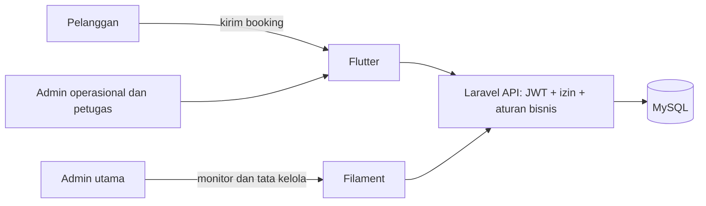

# Arsitektur dan otorisasi SIMuatanTahuna

## Batas aplikasi

- **Aplikasi web Filament** hanya dapat dimasuki `super_admin`. Fungsinya untuk memantau operasi, mengelola akun/master data, dan audit.
- **Aplikasi mobile** dipakai pelanggan dan staf. Menu mobile mengikuti role, sedangkan API tetap menjadi penentu akhir izin.
- Login API menolak `super_admin`, dan middleware pada seluruh endpoint ber-token menutup akses mobile untuk role tersebut, termasuk token lama.
- **Laravel API** memeriksa token JWT, status akun, izin tindakan, aturan bisnis, dan kepemilikan data sebelum membaca atau mengubah database.
- **MySQL** adalah sumber data utama. UI web dan mobile tidak boleh mengakali aturan API dengan menyembunyikan atau menampilkan tombol saja.

## Pembagian wewenang

| Role | Kanal dan tugas | Booking |
| --- | --- | --- |
| `super_admin` | Web; monitor, kelola akun/master data, audit | Baca saja; tidak membuat, mengubah, menghapus, atau memproses status |
| `admin` | Mobile; supervisi operasi, akun staf non-super-admin, master data, laporan | Baca dan koreksi data operasional; memproses status; tidak membuat atau menghapus |
| `operator` | Mobile; booking, manifest, dan voyage operasional | Baca, koreksi, dan proses status; tidak membuat atau menghapus |
| `checker` | Mobile; pencatatan realisasi muat/bongkar | Tidak mengakses tindakan booking |
| `upp` | Mobile; memeriksa dan memutuskan verifikasi manifest, laporan, audit | Baca untuk pengawasan; tidak mengubah booking |
| `manajer` | Mobile; laporan, analitik, dan pemantauan | Baca |
| `kantor_perhubungan` | Mobile; pengawasan lintas operasi, laporan, audit | Baca |
| `pelanggan` | Mobile; mengajukan dan melacak kirimannya | Membuat booking dan membaca booking miliknya sendiri |

Role diberikan per akun. Hak API ditetapkan di `RoleMiddleware`; aturan `denied_permissions` mengalahkan wildcard `*` milik admin utama. Karena itu, hak monitor admin utama tidak berubah menjadi hak tulis booking hanya karena ia memiliki hak sistem lain.

## Aturan booking

1. Hanya akun ber-role `pelanggan` dapat memanggil `POST /api/booking`.
2. Server mengambil `id_pelanggan` dari profil yang terikat ke token. Klien tidak boleh memilih atau memalsukan profil pelanggan.
3. Pelanggan hanya dapat melihat booking miliknya. Staf hanya menerima akses yang diberikan oleh izin role.
4. Admin utama melihat booking dari halaman Filament yang read-only. Tidak ada route buat/edit, tombol edit, atau hapus massal.
5. Admin/operator memproses booking lewat API mobile; status mengikuti transisi yang diizinkan. Booking tidak dihapus permanen supaya jejak operasional tetap tersedia; gunakan status pembatalan.

## Pemeriksaan akses berlapis

- **Navigasi Flutter/Filament:** hanya menampilkan modul dan tindakan yang relevan dengan role.
- **Middleware API:** menolak role tanpa izin sebelum controller berjalan.
- **Controller:** memvalidasi aturan bisnis dan mengulang batas penting, termasuk hanya pelanggan yang membuat booking.
- **Kepemilikan data:** query pelanggan dibatasi ke profilnya; ID dari aplikasi tidak dipercaya sebagai otorisasi.
- **Tracking publik:** hanya mengirim kode, rute, status, ringkasan barang, dan posisi. Data pelanggan/perusahaan, dokumen, serta detail petugas tidak dibuka tanpa login.
- **Status akun:** akun nonaktif ditolak walaupun tokennya belum kedaluwarsa.

Setiap endpoint baru harus ditambahkan ke matriks izin, diberi middleware permission, dan memiliki pemeriksaan kepemilikan jika datanya milik satu pengguna. Menyembunyikan tombol tanpa pengamanan server tidak dianggap otorisasi.
