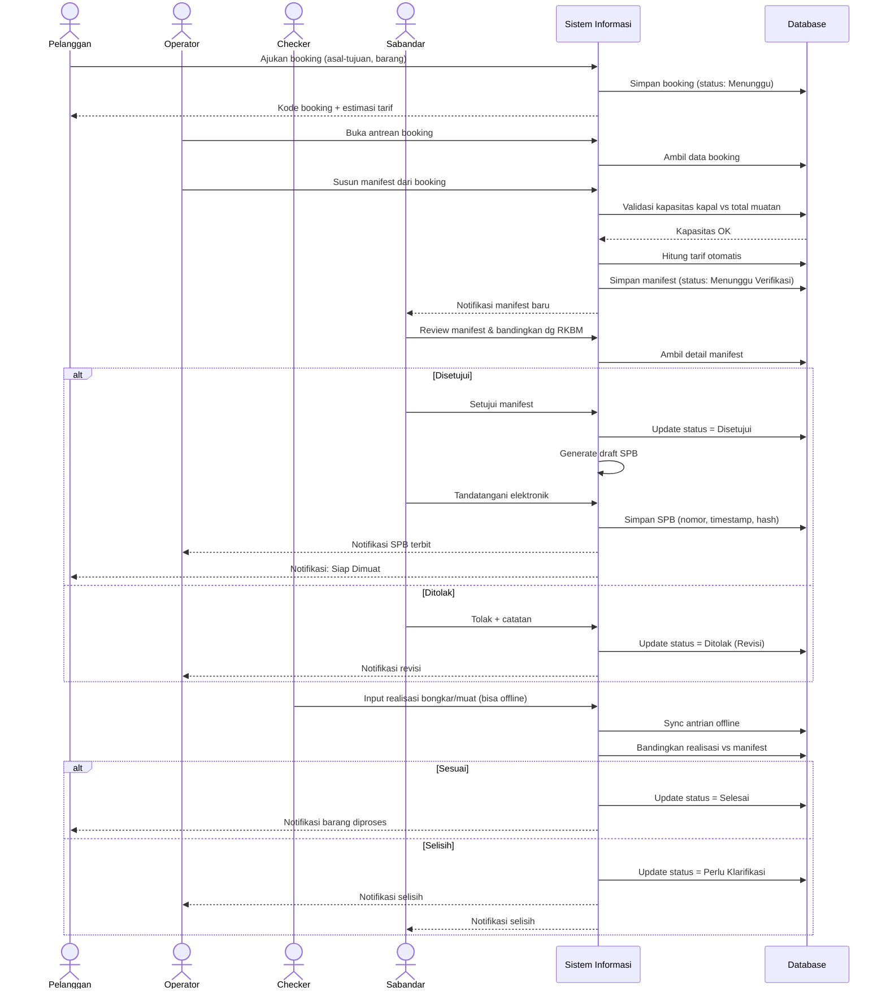
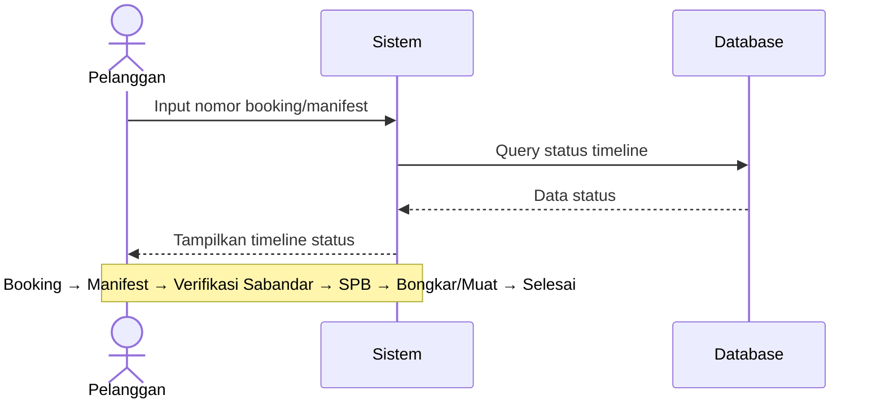
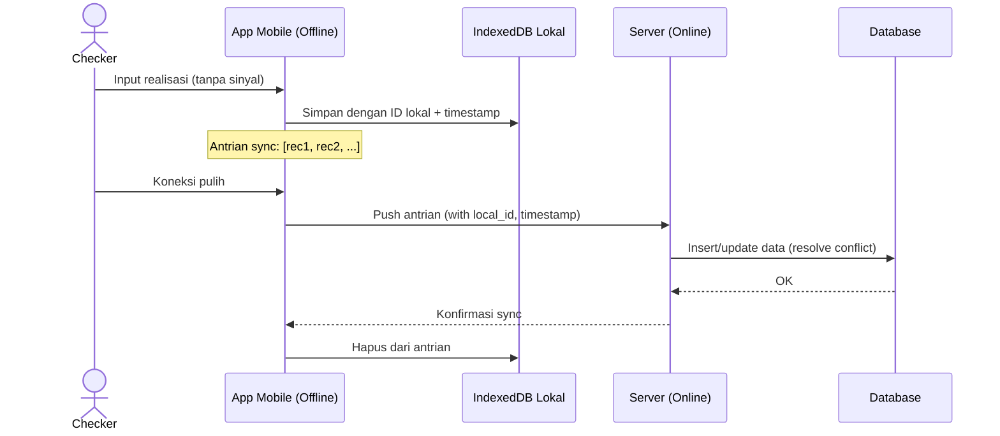
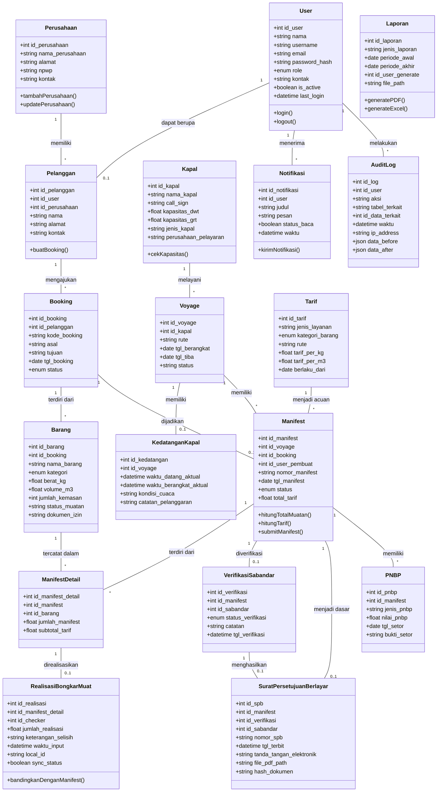
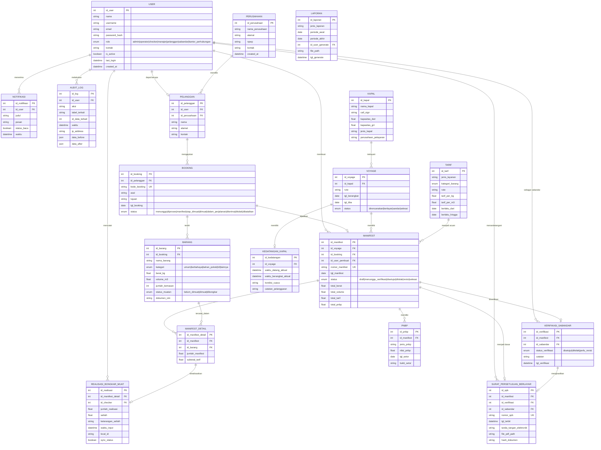
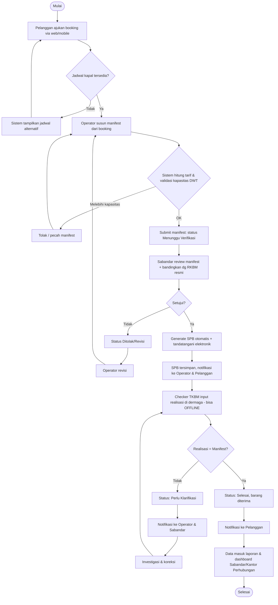
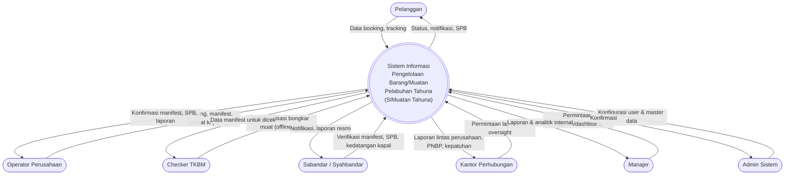
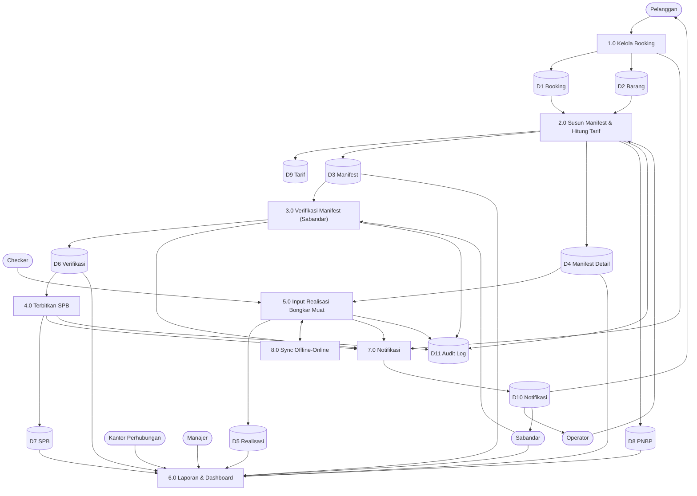

# Rancangan Sistem Informasi Pengelolaan Barang/Muatan dari/ke Pelabuhan Tahuna pada Jasa Perusahaan Transportasi

**Studi Kasus:** Pelabuhan Tahuna, Kabupaten Kepulauan Sangihe, Sulawesi Utara
**Simpul Pelayanan:** Tol Laut Surabaya–Makassar–Sangihe (pelabuhan pengumpul, kapasitas sandar ±5.000 DWT)
**Stack Teknologi:** Laravel 12 (Backend REST API + JWT) · Next.js 16 (Frontend App Router + TypeScript) · MySQL (XAMPP)

---

## Pendahuluan

### Latar Belakang
Pelabuhan Tahuna adalah satu-satunya pelabuhan pengumpul di Kabupaten Kepulauan Sangihe yang melayani arus penumpang dan barang dari/ke Pulau Sangihe (105 pulau, 26 berpenduduk). Secara geografis pelabuhan ini berada di kawasan perbatasan (dekat Mindanao, Filipina) dengan konektivitas internet yang fluktuatif. Sebagai simpul Tol Laut, pelabuhan ini menerima kiriman bahan pokok, material bangunan, BBM, serta mengirim keluar hasil bumi (kopra, cengkeh, pala, kelapa) dari Sangihe dan Talaud.

Dalam praktik harian yang masih berlaku:

1. **Pencatatan manifest, Rencana Kerja Bongkar Muat (RKBM), dan Surat Persetujuan Berlayar (SPB)** masih ditulis tangan di buku besar atau formulir cetak, lalu diarsipkan secara fisik di lemari. Risiko: dokumen hilang, rusak, sulit dicari, dan tidak ada jejak audit.
2. **Verifikasi barang di dermaga** dilakukan secara visual/petik oleh checker TKBM tanpa perbandingan otomatis dengan manifest — rawan selisih muatan.
3. **Perhitungan tarif dan PNBP** masih manual dengan kalkulator, rawan kesalahan hitung.
4. **Tidak ada tracking real-time** untuk pengirim barang; info hanya lewat telepon.
5. **Laporan bulanan** ke Kantor Perhubungan / Syahbandar direkap manual dari beberapa buku catatan, memakan waktu 2–3 hari.

### Tujuan Sistem
- **Menggantikan pencatatan manual** menjadi formulir digital multi-peran yang otomatis tervalidasi.
- **Mempercepat verifikasi Sabandar** atas manifest & RKBM dengan kontrol silang otomatis.
- **Mempermudah Kantor Perhubungan** mendapatkan laporan arus barang, kepatuhan, PNBP secara real-time.
- **Memberikan transparansi** bagi pengirim barang (tracking online).
- **Mendukung offline-first** karena lokasi kepulauan dengan sinyal terbatas, lalu sync otomatis saat online.

### Sasaran Pengguna
| Pengguna Utama | Kebutuhan Inti |
|---|---|
| **Sabandar / Syahbandar Pelabuhan Tahuna (UPP)** | Verifikasi manifest & RKBM, terbitkan SPB, pantau selisih, laporan resmi |
| **Kantor Perhubungan (Dishub Sangihe)** | Laporan lintas perusahaan, PNBP, kepatuhan, audit |
| **Operator Perusahaan Transportasi** | Input booking, susun manifest, jadwal kapal |
| **Checker TKBM (Bongkar Muat)** | Catat realisasi di dermaga (mobile, bisa offline) |
| **Pelanggan/Pengirim Barang** | Booking online & tracking |
| **Manajer Perusahaan** | Dashboard KPI internal |
| **Admin Sistem** | Kelola user, master data |

### Dampak yang Diharapkan
- **Efisiensi**: tutup buku harian turun dari 3 jam menjadi <15 menit.
- **Akuntabilitas**: 100% perubahan data manifest & realisasi tercatat di audit log.
- **Kepatuhan**: kontrol silang manifest vs realisasi otomatis, menurunkan selisih data.
- **Aksesibilitas**: tracking 24/7 untuk pelanggan tanpa telepon.
- **Konektivitas**: checker bisa input di dermaga tanpa sinyal, sync belakangan.

---

## Daftar Aktor Sistem

| Kode | Aktor | Peran dalam Sistem |
|---|---|---|
| **ADM** | Admin Sistem | Kelola user, role, master data |
| **OPR** | Petugas Perusahaan Transportasi (Operator) | Input booking, manifest, jadwal kapal |
| **CHK** | Petugas Bongkar Muat (Checker/TKBM) | Catat realisasi fisik (mobile/offline) |
| **CUS** | Pelanggan / Pengirim Barang | Booking online & tracking |
| **MJR** | Manajer Perusahaan | Dashboard analitik internal |
| **SBD** | Sabandar / Syahbandar (UPP) Pelabuhan Tahuna | Verifikasi manifest/RKBM, terbitkan SPB, laporan resmi |
| **KPH** | Kantor Perhubungan (Dishub Sangihe) | Laporan lintas perusahaan, PNBP, kepatuhan, oversight |

---

## 1. Use Case Diagram

```mermaid
graph TB
    Customer((Pelanggan))
    Operator((Operator Perusahaan))
    Checker((Checker TKBM))
    Manajer((Manajer))
    Admin((Admin Sistem))
    Sabandar((Sabandar/Syahbandar))
    Kantor((Kantor Perhubungan))

    subgraph "Sistem Informasi Pengelolaan Barang/Muatan Pelabuhan Tahuna"
        UC1[Login/Autentikasi Multi-role]
        UC2[Kelola Data Muatan/Barang]
        UC3[Buat & Kelola Manifest]
        UC4[Booking Pengiriman Barang]
        UC5[Input Realisasi Bongkar Muat]
        UC6[Tracking Status Muatan]
        UC7[Kelola Jadwal Kapal & Voyage]
        UC8[Kelola Data Pelanggan/Perusahaan]
        UC9[Verifikasi Manifest & RKBM]
        UC10[Terbitkan Surat Persetujuan Berlayar]
        UC11[Generate Laporan]
        UC12[Lihat Dashboard Analitik]
        UC13[Kelola User & Hak Akses]
        UC14[Notifikasi Status Muatan]
        UC15[Hitung Tarif & PNBP]
        UC16[Registrasi Kedatangan Kapal]
        UC17[Sync Data Offline-Online]
        UC18[Audit Trail & Log Aktivitas]
    end

    Customer --> UC1
    Customer --> UC4
    Customer --> UC6
    Customer --> UC14

    Operator --> UC1
    Operator --> UC2
    Operator --> UC3
    Operator --> UC7
    Operator --> UC8
    Operator --> UC15

    Checker --> UC1
    Checker --> UC5
    Checker --> UC6
    Checker --> UC17

    Manajer --> UC1
    Manajer --> UC11
    Manajer --> UC12

    Admin --> UC1
    Admin --> UC13
    Admin --> UC2
    Admin --> UC8

    Sabandar --> UC1
    Sabandar --> UC9
    Sabandar --> UC10
    Sabandar --> UC11
    Sabandar --> UC12
    Sabandar --> UC16
    Sabandar --> UC18

    Kantor --> UC1
    Kantor --> UC11
    Kantor --> UC12
    Kantor --> UC18

    UC3 -.include.-> UC9
    UC3 -.include.-> UC15
    UC9 -.include.-> UC10
    UC4 -.include.-> UC14
    UC5 -.include.-> UC6
    UC17 -.extend.-> UC5
    UC17 -.extend.-> UC2
```



---

## 2. Use Case Description

### UC-01 Login/Autentikasi Multi-role
| Item | Deskripsi |
|---|---|
| Aktor | Semua pengguna |
| Deskripsi | Login menggunakan username/email & password; token JWT dengan masa berlaku terbatas |
| Prasyarat | Akun aktif & terdaftar |
| Alur Utama | 1) User buka halaman login → 2) Input kredensial →  Sistem validasi → 4) Sistem arahkan ke dashboard sesuai role |
| Alur Alternatif | Gagal 3x → akun terkunci 15 menit & notifikasi reset; tersedia login offline dengan cache token |
| Postkondisi | Sesi (JWT) aktif |

### UC-02 Kelola Data Muatan/Barang
| Item | Deskripsi |
|---|---|
| Aktor | Operator, Admin |
| Deskripsi | CRUD data barang: nama, jenis, berat/volume, kemasan, kategori (umum/berbahaya/bahan pokok/B3) |
| Prasyarat | Login sebagai Operator/Admin |
| Alur Utama | 1) Buka menu Data Muatan → 2) Isi form →  Validasi → 4) Simpan |
| Alur Alternatif | Kategori B3 → wajib unggah dokumen izin (MSDS) |
| Postkondisi | Data barang tersimpan, siap masuk manifest |

### UC-03 Buat & Kelola Manifest
| Item | Deskripsi |
|---|---|
| Aktor | Operator |
| Deskripsi | Susun manifest per voyage: daftar barang, pengirim, penerima, kapal, rute, total tonase |
| Prasyarat | Data muatan & voyage tersedia |
| Alur Utama | 1) Pilih voyage → 2) Tarik barang dari booking atau input manual →  Sistem validasi kapasitas DWT → 4) Hitung tarif otomatis →  Submit |
| Alur Alternatif | Total > kapasitas → tolak & saran pecah manifest |
| Postkondisi | Manifest berstatus "Menunggu Verifikasi Sabandar" |
| Include | UC-09 (Verifikasi), UC-15 (Tarif) |

### UC-04 Booking Pengiriman Barang
| Item | Deskripsi |
|---|---|
| Aktor | Pelanggan |
| Deskripsi | Pengajuan online dari/ke Pelabuhan Tahuna dengan estimasi biaya |
| Prasyarat | Pelanggan terdaftar/login |
| Alur Utama | 1) Isi asal-tujuan & detail barang → 2) Sistem tampilkan jadwal kapal + estimasi tarif →  Konfirmasi → 4) Generate kode booking |
| Postkondisi | Booking "Menunggu Diproses", masuk antrean Operator |

### UC-05 Input Realisasi Bongkar Muat
| Item | Deskripsi |
|---|---|
| Aktor | Checker TKBM |
| Deskripsi | Catat jumlah barang yang benar-benar dibongkar/dimuat, bandingkan dengan manifest |
| Prasyarat | Manifest berstatus "Disetujui" |
| Alur Utama | 1) Pilih manifest aktif → 2) Scan QR/Barcode atau input manual →  Input jumlah realisasi → 4) Sistem bandingkan |
| Alur Alternatif | Selisih → tandai "Perlu Klarifikasi", kirim notifikasi ke Operator & Sabandar; **input bisa offline, akan sync saat online** |
| Postkondisi | Status muatan update |

### UC-06 Tracking Status Muatan
| Item | Deskripsi |
|---|---|
| Aktor | Pelanggan, Checker |
| Deskripsi | Lihat timeline status: Booking → Manifest → Verifikasi Sabandar → SPB → Bongkar/Muat → Selesai |

### UC-07 Kelola Jadwal Kapal & Voyage
| Item | Deskripsi |
|---|---|
| Aktor | Operator |
| Deskripsi | CRUD jadwal kapal, rute Tol Laut, kapasitas DWT, ETA/ETD |

### UC-08 Kelola Data Pelanggan/Perusahaan
| Item | Deskripsi |
|---|---|
| Aktor | Operator, Admin |
| Deskripsi | Registrasi & pemeliharaan data perusahaan (NPWP, kontak, alamat) |

### UC-09 Verifikasi Manifest & RKBM oleh Sabandar
| Item | Deskripsi |
|---|---|
| Aktor | Sabandar |
| Deskripsi | Sabandar verifikasi manifest terhadap dokumen resmi (RKBM, PKK) sebelum bongkar muat disetujui |
| Alur Utama | 1) Terima notifikasi manifest baru → 2) Buka detail, bandingkan dg RKBM →  Setujui/tolak dengan catatan |
| Alur Alternatif | Tolak → otomatis kembali ke Operator untuk revisi (status "Revisi") |
| Postkondisi | Status manifest "Disetujui" / "Ditolak" |
| Include | UC-10 (Terbitkan SPB jika disetujui) |

### UC-10 Terbitkan Surat Persetujuan Berlayar (SPB)
| Item | Deskripsi |
|---|---|
| Aktor | Sabandar (dengan delegasi sistem) |
| Deskripsi | Setelah manifest disetujui, sistem generate dokumen SPB resmi (PDF, nomor otomatis, tanda tangan elektronik Sabandar) |
| Alur Utama | 1) Manifest "Disetujui" → 2) Sistem generate template SPB → 3) Sabandar review & tandatangani elektronik → 4) Tersimpan di arsip digital |
| Postkondisi | SPB tersedia untuk diunduh, kapal diizinkan berlayar |

### UC-11 Generate Laporan
| Item | Deskripsi |
|---|---|
| Aktor | Operator, Sabandar, Kantor Perhubungan, Manajer |
| Deskripsi | Cetak laporan arus barang, manifest, selisih, PNBP, kepatuhan, kinerja kapal |
| Output | PDF (resmi) & Excel/CSV (analitik) |

### UC-12 Dashboard Analitik
| Item | Deskripsi |
|---|---|
| Aktor | Manajer, Sabandar, Kantor Perhubungan |
| Deskripsi | Visualisasi KPI: volume muatan, tren, kepatuhan, PNBP, top perusahaan, rute aktif |

### UC-13 Kelola User & Hak Akses
| Item | Deskripsi |
|---|---|
| Aktor | Admin |
| Deskripsi | CRUD user, role, permission per modul |

### UC-14 Notifikasi Status Muatan
| Item | Deskripsi |
|---|---|
| Aktor | Sistem (otomatis) → semua user |
| Deskripsi | Notifikasi in-app, email/WA saat status berubah |

### UC-15 Hitung Tarif & PNBP
| Item | Deskripsi |
|---|---|
| Aktor | Sistem (otomatis), diverifikasi Operator & Sabandar |
| Deskripsi | Hitung otomatis tarif bongkar muat & PNBP berdasarkan jenis barang, volume, rute; mengikuti tarif Kemenhub |
| Alur Utama | 1) Input barang + rute → 2) Sistem ambil tarif master →  Hitung → 4) Tampilkan rincian biaya di manifest |

### UC-16 Registrasi Kedatangan Kapal
| Item | Deskripsi |
|---|---|
| Aktor | Sabandar |
| Deskripsi | Catat waktu kedatangan kapal aktual, kondisi cuaca, pelanggaran; sumber data dwelling time |
| Postkondisi | Update status voyage, data masuk KPI |

### UC-17 Sync Data Offline-Online
| Item | Deskripsi |
|---|---|
| Aktor | Checker, Operator (mobile/PWA) |
| Deskripsi | Karena sinyal kepulauan terbatas, aplikasi mobile menyimpan data lokal (IndexedDB) lalu sync otomatis saat online |
| Alur Utama | 1) User kerja offline → 2) Data masuk antrian lokal →  Saat online → push ke server →  Resolusi konflik |

### UC-18 Audit Trail & Log Aktivitas
| Item | Deskripsi |
|---|---|
| Aktor | Sabandar, Kantor Perhubungan, Admin |
| Deskripsi | Akses log seluruh perubahan data sensitif untuk kebutuhan audit & investigasi |

---

## 3. Sequence Diagram

### 3.1 Sequence: Booking → Manifest → Verifikasi Sabandar → SPB → Realisasi



### 3.2 Sequence: Pelacakan oleh Pelanggan



### 3.3 Sequence: Sync Offline Checker



---

## 4. Class Diagram



---

## 5. Entity Relationship Diagram (ERD)



---

## 6. Relasi Database / Logical Database Design

**Normalisasi:** 3NF (tidak ada redundansi; data master dipisah dari transaksi; historis tetap utuh walau master berubah).
**Engine:** MySQL InnoDB (XAMPP), charset utf8mb4.

| Tabel | Kolom Utama | Tipe Kunci | Relasi |
|---|---|---|---|
| `users` | id_user (PK), nama, username, email, password_hash, role (ENUM), kontak, is_active, last_login, created_at | PK: id_user | 1-N ke `notifikasi`, `audit_log`, `manifest`, `realisasi_bongkar_muat`, `verifikasi_sabandar`, `surat_persetujuan_berlayar` |
| `perusahaan` | id_perusahaan (PK), nama_perusahaan, alamat, npwp, kontak, created_at | PK: id_perusahaan | 1-N ke `pelanggan` |
| `pelanggan` | id_pelanggan (PK), id_user (FK), id_perusahaan (FK), nama, alamat, kontak | PK: id_pelanggan, FK: id_user → users, id_perusahaan → perusahaan | 1-N ke `booking` |
| `kapal` | id_kapal (PK), nama_kapal, call_sign, kapasitas_dwt, kapasitas_grt, jenis_kapal, perusahaan_pelayaran | PK: id_kapal | 1-N ke `voyage` |
| `voyage` | id_voyage (PK), id_kapal (FK), rute, tgl_berangkat, tgl_tiba, status | PK: id_voyage, FK: id_kapal → kapal | 1-N ke `manifest`, 1-1 ke `kedatangan_kapal` |
| `kedatangan_kapal` | id_kedatangan (PK), id_voyage (FK), waktu_datang_aktual, waktu_berangkat_aktual, kondisi_cuaca, catatan_pelanggaran | PK: id_kedatangan, FK: id_voyage → voyage | - |
| `booking` | id_booking (PK), id_pelanggan (FK), kode_booking (unique), asal, tujuan, tgl_booking, status (ENUM) | PK: id_booking, FK: id_pelanggan → pelanggan | 1-N ke `barang`, 1-1 ke `manifest` |
| `barang` | id_barang (PK), id_booking (FK), nama_barang, kategori (ENUM), berat_kg, volume_m3, jumlah_kemasan, status_muatan, dokumen_izin | PK: id_barang, FK: id_booking → booking | 1-N ke `manifest_detail` |
| `tarif` | id_tarif (PK), jenis_layanan, kategori_barang, rute, tarif_per_kg, tarif_per_m3, berlaku_dari, berlaku_hingga | PK: id_tarif | Referensi untuk manifest |
| `manifest` | id_manifest (PK), id_voyage (FK), id_booking (FK), id_user_pembuat (FK), nomor_manifest (unique), tgl_manifest, status (ENUM), total_berat, total_volume, total_tarif, total_pnbp | PK: id_manifest, FK: id_voyage → voyage, id_booking → booking, id_user_pembuat → users | 1-N ke `manifest_detail`, 1-1 ke `verifikasi_sabandar` & `surat_persetujuan_berlayar`, 1-N ke `pnbp` |
| `manifest_detail` | id_manifest_detail (PK), id_manifest (FK), id_barang (FK), jumlah_manifest, subtotal_tarif | PK: id_manifest_detail, FK: id_manifest → manifest, id_barang → barang | 1-1 ke `realisasi_bongkar_muat` |
| `realisasi_bongkar_muat` | id_realisasi (PK), id_manifest_detail (FK), id_checker (FK), jumlah_realisasi, selisih, keterangan_selisih, waktu_input, local_id, sync_status | PK: id_realisasi, FK: id_manifest_detail → manifest_detail, id_checker → users | - |
| `verifikasi_sabandar` | id_verifikasi (PK), id_manifest (FK), id_sabandar (FK), status_verifikasi (ENUM), catatan, tgl_verifikasi | PK: id_verifikasi, FK: id_manifest → manifest, id_sabandar → users | 1-1 ke `surat_persetujuan_berlayar` |
| `surat_persetujuan_berlayar` | id_spb (PK), id_manifest (FK), id_verifikasi (FK), id_sabandar (FK), nomor_spb (unique), tgl_terbit, tanda_tangan_elektronik, file_pdf_path, hash_dokumen | PK: id_spb, FK: id_manifest → manifest, id_verifikasi → verifikasi_sabandar, id_sabandar → users | - |
| `pnbp` | id_pnbp (PK), id_manifest (FK), jenis_pnbp, nilai_pnbp, tgl_setor, bukti_setor | PK: id_pnbp, FK: id_manifest → manifest | - |
| `notifikasi` | id_notifikasi (PK), id_user (FK), judul, pesan, status_baca, waktu | PK: id_notifikasi, FK: id_user → users | - |
| `laporan` | id_laporan (PK), jenis_laporan, periode_awal, periode_akhir, id_user_generate (FK), file_path, tgl_generate | PK: id_laporan, FK: id_user_generate → users | - |
| `audit_log` | id_log (PK), id_user (FK), aksi, tabel_terkait, id_data_terkait, waktu, ip_address, data_before (JSON), data_after (JSON) | PK: id_log, FK: id_user → users | - |

**Index tambahan yang disarankan:**
- `booking.kode_booking` UNIQUE, `manifest.nomor_manifest` UNIQUE, `surat_persetujuan_berlayar.nomor_spb` UNIQUE
- `manifest.status`, `voyage.status`, `realisasi_bongkar_muat.sync_status` (untuk query cepat)
- `audit_log(tabel_terkait, id_data_terkait)` (untuk audit per data)

---

## 7. Flowchart (Alur Proses Utama Pengelolaan Muatan)



---

## 8. Data Flow Diagram (DFD)

### 8.1 DFD Level 0 (Diagram Konteks)



### 8.2 DFD Level 1 (Rincian Proses)



---

## 9. Wireframe (Deskripsi Layar Utama)

### 9.1 Halaman Login
```
+--------------------------------------------------+
|        SIMuatan Pelabuhan Tahuna                 |
|        Kabupaten Kepulauan Sangihe               |
|                                                    |
|   [ Username / Email ______________ ]             |
|   [ Password ______________________ ]             |
|                                                    |
|              ( LOGIN )   Lupa password?           |
+--------------------------------------------------+
```

### 9.2 Dashboard Sabandar (Kunci Utama)
```
+------------------------------------------------------------------------+
| LOGO  SIMuatan Tahuna       [User: Sabandar]  [Logout]                 |
+------------------------------------------------------------------------+
| Ringkasan Hari Ini                                                      |
| [Kapal Sandar: 2] [Manifest Menunggu: 5] [SPB Terbit: 3] [Selisih: 1]  |
+------------------------------------------------------------------------+
| ANTRIAN VERIFIKASI MANIFEST                                             |
| No.Manifest | Kapal    | Voyage  | Total Muatan | Status     | Aksi     |
| MNF-001    | KM Laut  | SBY-MKS-Tahuna | 3.500 kg | Menunggu | [Review] |
| MNF-002    | KM Sangihe | MKS-Tahuna   | 1.200 kg | Menunggu | [Review] |
+------------------------------------------------------------------------+
| SPB Terbitan Hari Ini              | Statistik Kepatuhan              |
| - SPB-20260830-001 (MNF-001)       | % Manifest Sesuai: 92%          |
| - SPB-20260830-002 (MNF-003)       | Rata-rata Dwelling Time: 18 jam |
+------------------------------------------------------------------------+
```

### 9.3 Form Review Manifest oleh Sabandar
```
+------------------------------------------------------------------------+
| Review Manifest #MNF-001     [Setujui] [Tolak] [Minta Revisi]          |
|------------------------------------------------------------------------|
| Voyage: KM Laut - Surabaya/Makassar/Tahuna   Tgl Berangkat: 30-08-2026 |
| Perusahaan: PT Pelayaran Nusantara            Tgl Tiba: 02-09-2026    |
+------------------------------------------------------------------------+
| Barang             | Pengirim     | Penerima   | Jumlah  | Berat      |
|--------------------|--------------|------------|---------|------------|
| Sembako            | CV Sejahtera | Toko Maju  | 50 box  | 500 kg     |
| Kopra              | CV Laut Biru | PT Ekspor  | 100 sak | 3.000 kg   |
|------------------------------------------------------------------------|
| Total Muatan: 3.500 kg / Kapasitas Kapal: 5.000 DWT (OK 70%)           |
|------------------------------------------------------------------------|
| Rincian Tarif & PNBP:                                                   |
| - Tarif Bongkar Muat: Rp 1.750.000                                     |
| - PNBP: Rp 350.000                                                     |
| - Total: Rp 2.100.000                                                  |
|------------------------------------------------------------------------|
| Bandingkan dengan RKBM: [Lihat RKBM]                                    |
| Catatan Sabandar: [_____________________________________________]       |
+------------------------------------------------------------------------+
```

### 9.4 Dashboard Kantor Perhubungan
```
+------------------------------------------------------------------------+
| LOGO  SIMuatan Tahuna       [User: Kantor Perhubungan]  [Logout]       |
+------------------------------------------------------------------------+
| Laporan Lintas Perusahaan                                                |
| [Dropdown: Periode] [Dropdown: Perusahaan] [Generate Laporan]          |
+------------------------------------------------------------------------+
| Grafik Arus Barang 12 Bulan (Semua Perusahaan di Pelabuhan Tahuna)      |
| [Bar Chart] Volume Datang (in) vs Volume Keluar (out)                   |
+------------------------------------------------------------------------+
| KPI Operasional                                                          |
| - Total Booking Bulan Ini: 145                                          |
| - Total Manifest Disetujui: 132                                         |
| - Total PNBP Tersetor: Rp 45.500.000                                    |
| - % Kepatuhan Manifest: 92%                                             |
| - Perusahaan Aktif: 12                                                  |
+------------------------------------------------------------------------+
| Tabel Perusahaan & Kepatuhan                                            |
| Perusahaan | Booking | Selisih | PNBP | Status                          |
| PT A       | 25      | 1       | 8jt  | OK                              |
| PT B       | 18      | 3       | 6jt  | Perlu Perhatian                 |
+------------------------------------------------------------------------+
```

### 9.5 Dashboard Operator Perusahaan
```
+----------------------------------------------------------+
| LOGO   Menu: Booking | Manifest | Jadwal | Laporan | [User v]
+----------------------------------------------------------+
| Ringkasan Hari Ini                                        |
| [Booking Baru: 5] [Manifest Menunggu: 2] [Selesai: 12]    |
+----------------------------------------------------------+
| Daftar Booking Terbaru                                    |
| No | Pelanggan | Barang     | Tujuan | Status    | Aksi   |
| 01 | PT Sejahtera | Sembako | Tahuna | Menunggu | [Proses]|
| 02 | CV Laut Biru | Kopra   | Tahuna | Manifest | [Lihat] |
+----------------------------------------------------------+
```

### 9.6 Mobile Checker (Offline-Ready)
```
+--------------------------------+
| [Offline Mode - Data Tersimpan]|
+--------------------------------+
| Voyage: KM Laut SBY-Tahuna     |
| Manifest: MNF-001              |
+--------------------------------+
| Barang: Kopra                   |
| Manifest: 100 sak              |
| Realisasi: [______] sak        |
| Catatan: [____________]        |
| [SIMPAN (Offline)]             |
+--------------------------------+
| Antrean Sync: 3 data          |
| Status Sinyal: [X] Offline    |
+--------------------------------+
```

### 9.7 Form Input Manifest
```
+----------------------------------------------------------+
| Buat Manifest Baru                                        |
| Voyage: [ Pilih Kapal & Rute v ]  No. Manifest: (auto)    |
|------------------------------------------------------------|
| Tambah Barang dari Booking:                                |
| [x] Sembako - 500 kg - PT Sejahtera                        |
| [x] Kopra - 1200 kg - CV Laut Biru                          |
|------------------------------------------------------------|
| Total Muatan: 1700 kg / Kapasitas Kapal: 5000 DWT   [OK]   |
| Estimasi Tarif: Rp 850.000  PNBP: Rp 170.000  Total: Rp 1.020.000
|                                        [ SUBMIT MANIFEST ] |
+----------------------------------------------------------+
```

### 9.8 Layar Tracking Pelanggan
```
+----------------------------------------------------------+
| Lacak Status Barang     [ Masukkan No. Booking ] [Cari]   |
+----------------------------------------------------------+
| Booking #BK00231                                           |
|  o Booking Diterima         (28 Aug 2026)                  |
|  o Manifest Dibuat          (28 Aug 2026)                  |
|  o Diverifikasi Sabandar    (29 Aug 2026)                  |
|  o SPB Terbit               (29 Aug 2026)                  |
|  o Dimuat ke Kapal          (29 Aug 2026)                  |
|  o Dalam Perjalanan         -                              |
|  o Diterima di Tujuan       -                              |
+----------------------------------------------------------+
```

### 9.9 Dashboard Analitik (Manajer)
```
+----------------------------------------------------------+
| Dashboard Analitik Arus Barang Pelabuhan Tahuna            |
+----------------------------------------------------------+
| [Grafik Batang: Muatan Datang vs Balik per Bulan]           |
| [Grafik Garis: Tren Volume Muatan 12 Bulan Terakhir]         |
| [Pie Chart: Komposisi Kategori Barang]                       |
| [Kartu KPI: % Manifest Sesuai | Selisih Data | Dwelling]    |
+----------------------------------------------------------+
```

---

## 10. Arsitektur Sistem (Revisi: Offline-First & Multi-Sabandar)

```mermaid
flowchart TB
    subgraph Client["Lapisan Client (Multi-Platform)"]
        A1[Web App - Next.js: Operator/Admin/Manajer]
        A2[Web App - Next.js: Sabandar & Kantor Perhubungan]
        A3[PWA/Mobile App - Checker TKBM<br/>(offline-ready, IndexedDB)]
        A4[Web/Mobile - Pelanggan]
    end

    subgraph Edge["Lapisan Edge"]
        B1[CDN - Aset statis]
        B2[Load Balancer / Reverse Proxy]
        B3[API Gateway + Rate Limiter]
    end

    subgraph App["Lapisan Aplikasi (Backend Laravel 12)"]
        C1[Modul Autentikasi & RBAC]
        C2[Modul Booking]
        C3[Modul Manifest & Tarif]
        C4[Modul Verifikasi & SPB]
        C5[Modul Realisasi & Sync]
        C6[Modul Laporan & Analitik]
        C7[Modul Notifikasi]
        C8[Modul Audit & Compliance]
    end

    subgraph Data["Lapisan Data"]
        D1[(MySQL - Data Transaksional)]
        D2[(File Storage - PDF SPB, Laporan)]
        D3[(Redis - Cache & Session)]
        D4[(Queue - Email/WA Gateway)]
    end

    subgraph Ext["Integrasi Eksternal"]
        E1[Inaportnet / SIMLALA - Kemenhub]
        E2[Email Gateway]
        E3[WhatsApp Gateway - Notifikasi]
        E4[Tanda Tangan Elektronik - BSrE/Privy]
    end

    A1 --> B1
    A2 --> B1
    A3 -.HTTP.-> B3
    A4 --> B1
    B1 --> B2 --> B3
    B3 --> C1
    B3 --> C2
    B3 --> C3
    B3 --> C4
    B3 --> C5
    B3 --> C6
    B3 --> C7
    B3 --> C8

    C1 --> D3
    C2 --> D1
    C3 --> D1
    C4 --> D1
    C4 --> D2
    C4 --> E4
    C5 --> D1
    C5 -.offline queue.-> A3
    C6 --> D1
    C6 --> D2
    C7 --> D4
    C8 --> D1
    C3 -.laporan manifest.-> E1
    C4 -.SPB & verifikasi.-> E1
    C7 --> E2
    C7 --> E3
```

**Catatan arsitektur (revisi agar berdampak & mudah dipakai):**

1. **Offline-first untuk Checker TKBM**: PWA/Mobile app dengan IndexedDB/SQLite (via RxDB/Dexie) menyimpan data lokal + antrian sync. Saat koneksi tersedia, antrian dikirim ke server. Penting karena dermaga Tahuna memiliki sinyal 3G/4G terbatas.
2. **API Gateway + Rate Limiter**: mencegah abuse, dan menjadi titik integrasi jika nanti di-deploy ke multi-cabang.
3. **Tanda Tangan Elektronik**: integrasi dengan BSrE (Badan Sertifikasi Elektronik) atau Privy untuk SPB Sabandar, sah secara hukum (UU ITE).
4. **CDN** untuk aset frontend agar tetap cepat walau jaringan terbatas.
5. **Queue system** (Laravel Queue + Redis) untuk notifikasi email/WA agar tidak menghambat user experience.
6. **Audit & Compliance module**: berdiri sendiri agar mudah di-extract untuk kebutuhan audit Kemenhub.
7. **Pola 3-tier** dipertahankan agar mudah migrasi ke microservice (Kubernetes) jika traffic meningkat.
8. **Integrasi Inaportnet/SIMLALA**: disesuaikan dengan kebijakan digitalisasi pelabuhan nasional; sifatnya opsional tahap lanjut.

**Justifikasi pemilihan teknologi:**
- **Laravel 12**: ekosistem REST API & Eloquent ORM matang, queue/notification built-in, cocok untuk backend administrasi pelabuhan.
- **Next.js 16**: SSR untuk SEO/dashboard ringan, App Router untuk multi-role, integrasi API mudah.
- **MySQL**: stabil, free, familiar untuk XAMPP; mendukung transaksi ACID untuk data manifest/SPB.
- **PWA + IndexedDB**: solusi murah untuk offline di dermaga tanpa biaya mobile app terpisah.

---

## 11. Rancangan Keamanan

| Aspek | Rancangan |
|---|---|
| **Autentikasi** | Login berbasis username/email + password (bcrypt/argon2); opsional OTP untuk Sabandar & Admin |
| **Otorisasi** | **Role-Based Access Control (RBAC)** dengan 7 role: admin, operator, checker, manajer, pelanggan, sabandar, kantor_perhubungan. Setiap role hanya dapat mengakses endpoint sesuai policy |
| **Sesi & Token** | JWT access token (exp 60 menit) + refresh token (exp 14 hari); auto-logout setelah idle; token disimpan httpOnly cookie |
| **Transmisi Data** | HTTPS/TLS 1.3 wajib untuk seluruh komunikasi client-server |
| **Enkripsi Data Sensitif** | Data NPWP, kontak pelanggan dienkripsi at-rest (AES-256); kolom sensitif di-exclude dari log |
| **Tanda Tangan Elektronik** | SPB ditandatangani elektronik via BSrE/Privy untuk keabsahan hukum (UU ITE) |
| **Audit Trail** | Setiap perubahan data pada manifest, realisasi, verifikasi, SPB dicatat di `audit_log` (siapa, kapan, apa, before/after, IP) — penting untuk investigasi kasus selisih muatan |
| **Validasi Input** | Server-side validation (FormRequest di Laravel); sanitasi untuk cegah SQL Injection, XSS, CSRF (Laravel CSRF token) |
| **Rate Limiting** | Laravel Throttle: 60 req/menit per user, 10 req/menit untuk login (anti-brute force) |
| **CORS** | Whitelist domain frontend & mobile; tolak origin lain |
| **Backup & Recovery** | Backup database harian (mysqldump + cron), offsite ke cloud (S3/Backblaze); DRP: restore <4 jam |
| **Segregation of Duty** | User yang input manifest tidak sama dengan yang verifikasi (Sabandar) dan yang catat realisasi (Checker); kontrol silang otomatis |
| **Logging Sensitif** | Akses ke data manifest & SPB di-log untuk compliance; log retensi 1 tahun |
| **Keamanan Mobile** | PWA dengan HTTPS, token storage di secure storage, biometric login opsional |

---

## 12. Rancangan API (REST)

**Base URL:** `https://api.simuatan-tahuna.go.id/v1`
**Autentikasi:** `Authorization: Bearer <JWT>`
**Content-Type:** `application/json`

### 12.1 Autentikasi
| Method | Endpoint | Deskripsi | Role |
|---|---|---|---|
| POST | `/auth/login` | Login | Publik |
| POST | `/auth/logout` | Logout | Semua |
| POST | `/auth/refresh` | Refresh token | Semua |
| GET | `/auth/me` | Profil user aktif | Semua |

### 12.2 Master Data
| Method | Endpoint | Deskripsi | Role |
|---|---|---|---|
| GET | `/perusahaan` | Daftar perusahaan | Admin, Operator, Sabandar, Kantor |
| POST | `/perusahaan` | Tambah perusahaan | Admin, Operator |
| GET | `/perusahaan/{id}` | Detail perusahaan | Admin, Operator, Sabandar |
| PUT | `/perusahaan/{id}` | Update perusahaan | Admin, Operator |
| GET | `/kapal` | Daftar kapal | Semua |
| POST | `/kapal` | Tambah kapal | Admin, Operator |
| GET | `/voyage` | Daftar voyage/jadwal | Semua |
| POST | `/voyage` | Tambah voyage | Operator, Sabandar |
| GET | `/voyage/{id}/cek-kapasitas` | Validasi muatan vs kapasitas | Operator, Sabandar |
| GET | `/tarif` | Daftar tarif | Operator, Sabandar |
| POST | `/tarif` | Tambah/update tarif | Admin |

### 12.3 Booking & Barang
| Method | Endpoint | Deskripsi | Role |
|---|---|---|---|
| GET | `/booking` | Daftar booking | Semua (filtered by role) |
| POST | `/booking` | Buat booking | Pelanggan, Operator |
| GET | `/booking/{id}` | Detail booking | Pelanggan, Operator, Sabandar |
| PUT | `/booking/{id}` | Update booking | Operator, Admin |
| DELETE | `/booking/{id}` | Hapus booking | Admin |
| GET | `/booking/{id}/transitions` | Status transition yang valid | Operator, Admin |
| PUT | `/booking/{id}/status` | Update status booking | Operator, Sabandar |
| GET | `/booking-tracking/{kode}` | Tracking publik | Publik |
| POST | `/barang` | Tambah barang ke booking | Operator, Pelanggan |
| GET | `/barang/{booking_id}` | Daftar barang per booking | Semua (filtered) |

### 12.4 Manifest & Tarif
| Method | Endpoint | Deskripsi | Role |
|---|---|---|---|
| GET | `/manifest` | Daftar manifest | Admin, Operator, Sabandar, Manajer |
| POST | `/manifest` | Buat manifest | Operator |
| GET | `/manifest/{id}` | Detail manifest | Semua (filtered) |
| PUT | `/manifest/{id}` | Update manifest | Operator |
| PUT | `/manifest/{id}/submit` | Submit untuk verifikasi | Operator |
| GET | `/manifest/{id}/tarif` | Hitung tarif manifest | Operator, Sabandar |

### 12.5 Verifikasi Sabandar & SPB
| Method | Endpoint | Deskripsi | Role |
|---|---|---|---|
| GET | `/verifikasi/antrian` | Daftar manifest menunggu verifikasi | Sabandar, Admin |
| PUT | `/verifikasi/{manifest_id}` | Setujui/tolak/revisi manifest | Sabandar |
| POST | `/spb/generate/{verifikasi_id}` | Generate SPB dari verifikasi | Sabandar |
| GET | `/spb/{id}` | Lihat SPB (PDF URL) | Sabandar, Operator, Kantor |
| GET | `/spb/{id}/download` | Download SPB PDF | Sabandar, Operator |

### 12.6 Realisasi Bongkar Muat
| Method | Endpoint | Deskripsi | Role |
|---|---|---|---|
| GET | `/realisasi` | Daftar realisasi | Semua (filtered) |
| POST | `/realisasi` | Input realisasi | Checker, Admin |
| PUT | `/realisasi/{id}` | Koreksi realisasi (dengan audit) | Checker, Admin |
| POST | `/realisasi/sync` | Bulk sync dari antrian offline | Checker (auto) |
| GET | `/realisasi/selisih` | Laporan selisih manifest vs realisasi | Operator, Sabandar, Kantor |

### 12.7 Kedatangan Kapal
| Method | Endpoint | Deskripsi | Role |
|---|---|---|---|
| POST | `/kedatangan` | Catat kedatangan/keberangkatan aktual | Sabandar |
| GET | `/kedatangan → voyage_id=` | Daftar kedatangan | Sabandar, Operator |

### 12.8 Laporan
| Method | Endpoint | Deskripsi | Role |
|---|---|---|---|
| GET | `/laporan/arus-barang → periode_awal=&periode_akhir=` | Laporan arus barang | Operator, Sabandar, Manajer, Kantor |
| GET | `/laporan/manifest → voyage_id=` | Laporan manifest | Operator, Sabandar |
| GET | `/laporan/selisih-manifest → periode=` | Laporan selisih | Sabandar, Kantor |
| GET | `/laporan/pnbp → periode=` | Laporan PNBP | Sabandar, Kantor |
| GET | `/laporan/kinerja-kapal → periode=` | Kinerja kapal/voyage | Manajer, Kantor |
| GET | `/laporan/perusahaan → periode=` | Laporan per perusahaan | Kantor, Manajer |
| GET | `/laporan/audit → periode=` | Laporan audit log | Admin, Sabandar, Kantor |
| POST | `/laporan/export` | Generate PDF/Excel | Sesuai jenis laporan |

### 12.9 Dashboard Analitik
| Method | Endpoint | Deskripsi | Role |
|---|---|---|---|
| GET | `/dashboard/summary → role=` | Ringkasan KPI sesuai role | Semua |
| GET | `/dashboard/arus-barang → periode=` | Data arus barang chart | Manajer, Sabandar, Kantor |
| GET | `/dashboard/trend-bulanan → tahun=` | Tren volume 12 bulan | Manajer, Sabandar, Kantor |
| GET | `/dashboard/kepatuhan → periode=` | % manifest sesuai | Sabandar, Kantor |
| GET | `/dashboard/top-perusahaan → periode=` | Top 5 perusahaan | Manajer, Kantor |
| GET | `/dashboard/rute-aktif` | Rute Tol Laut aktif | Sabandar, Operator |

### 12.10 Notifikasi
| Method | Endpoint | Deskripsi | Role |
|---|---|---|---|
| GET | `/notifikasi` | Daftar notifikasi user | Semua |
| PUT | `/notifikasi/{id}/read` | Tandai dibaca | Semua |
| PUT | `/notifikasi/read-all` | Tandai semua dibaca | Semua |
| POST | `/notifikasi/test` | Test kirim notifikasi | Admin |

### 12.11 User & Audit
| Method | Endpoint | Deskripsi | Role |
|---|---|---|---|
| GET | `/users` | Daftar user | Admin |
| POST | `/users` | Tambah user | Admin |
| PUT | `/users/{id}` | Update user | Admin |
| DELETE | `/users/{id}` | Nonaktifkan user | Admin |
| GET | `/audit-log → tabel=&id_data=` | Lihat audit log | Admin, Sabandar, Kantor |

### 12.12 Format Respons Standar
```json
{
  "status": "success | error",
  "message": "Pesan deskriptif",
  "data": { ... },
  "errors": { "field": ["..."] },
  "meta": { "page": 1, "per_page": 20, "total": 100 }
}
```

**Error codes khusus:**
- `AUTH_001` Unauthenticated, `AUTH_002` Akun nonaktif, `AUTH_003` Token expired
- `ROLE_001` Role tidak diizinkan, `ROLE_002` Resource bukan milik role
- `VALIDATION_ERROR`, `BOOKING_NOT_FOUND`, `BOOKING_FINAL_STATE`
- `MANIFEST_EXISTS`, `MANIFEST_NOT_APPROVED`, `MANIFEST_INVALID_STATUS`
- `INVALID_STATUS_TRANSITION`, `REASON_REQUIRED`
- `KAPASITAS_MELAMPAUI`, `SELISIH_TERDETEKSI`
- `OFFLINE_SYNC_CONFLICT` (perlu resolusi manual)

---

## 13. Rancangan Laporan

| No | Nama Laporan | Isi / Kolom Utama | Periode | Penerima | Format |
|---|---|---|---|---|---|
| 1 | **Laporan Arus Barang (Harian/Bulanan)** | Tanggal, jenis barang, kategori, berat/volume, asal-tujuan, muatan datang vs balik | Harian/Bulanan | Sabandar, Kantor Perhubungan, Manajer | PDF + Excel |
| 2 | **Laporan Manifest** | No. manifest, voyage, kapal, daftar barang, status verifikasi, tarif, PNBP | Per voyage / periode | Sabandar, Operator | PDF + Excel |
| 3 | **Laporan Selisih Bongkar Muat** | No. manifest, manifest vs realisasi, selisih, keterangan, petugas | Per kejadian/bulanan | Sabandar, Kantor Perhubungan | PDF + Excel |
| 4 | **Laporan Kinerja Kapal/Voyage** | Kapal, rute, jumlah trip, rata-rata dwelling time, volume muatan | Bulanan | Manajer, Kantor | PDF + Excel |
| 5 | **Laporan Pelanggan/Perusahaan** | Volume kiriman per perusahaan, frekuensi booking, kontribusi PNBP | Bulanan/Tahunan | Kantor, Manajer | PDF + Excel |
| 6 | **Laporan PNBP** | Jenis PNBP, nilai, tanggal setor, bukti setor, manifest referensi | Bulanan/Tahunan | Sabandar, Kantor | PDF + Excel |
| 7 | **Laporan SPB Terbit** | Nomor SPB, manifest, kapal, voyage, tanggal, penandatangan | Harian/Bulanan | Sabandar, Kantor | PDF + Excel |
| 8 | **Laporan Audit Sistem** | Log aktivitas user pada data sensitif (manifest, realisasi, SPB, user) | Sesuai kebutuhan | Admin, Sabandar, Kantor | PDF + Excel |
| 9 | **Laporan Kepatuhan Perusahaan** | Daftar perusahaan, % kepatuhan manifest, jumlah pelanggaran | Bulanan/Tahunan | Kantor, Sabandar | PDF + Excel |
| 10 | **Laporan Bulanan ke Kemenhub** | Agregasi laporan 1-9 sesuai format Inaportnet/SIMLALA | Bulanan | Kantor (submit) | XML/CSV ke Inaportnet |

**Format ekspor:**
- **PDF** (dengan kop surat resmi, QR code verifikasi, tanda tangan elektronik untuk SPB/laporan resmi)
- **Excel/CSV** (untuk analisis lanjutan di luar sistem)
- **Cetak langsung** dari browser (template CSS print-friendly)

---

## 14. Rancangan Dashboard Analitik

### 14.1 Dashboard Sabandar (Fokus Operasional & Compliance)
| Widget | Jenis Visual | Sumber Data | Tujuan |
|---|---|---|---|
| Kapal Sedang Sandar | Tabel real-time | `voyage`, `kedatangan_kapal` | Monitoring dermaga |
| Antrian Manifest Menunggu Verifikasi | Tabel dengan badge SLA | `manifest.status = menunggu_verifikasi` | Prioritas kerja Sabandar |
| % Manifest Disetujui vs Ditolak | KPI card + donut | `verifikasi_sabandar` | Indikator kualitas kerja |
| SPB Terbit Hari Ini | KPI card + list | `surat_persetujuan_berlayar` | Output harian Sabandar |
| Selisih Muatan (Bongkar Muat) | KPI card + tabel | `realisasi_bongkar_muat.selisih` | Compliance control |
| Rata-rata Dwelling Time | KPI card | Selisih waktu manifest disetujui → realisasi selesai | Efisiensi pelabuhan |
| Aktivitas Audit Terbaru | Timeline | `audit_log` (manifest, SPB, realisasi) | Keamanan & akuntabilitas |

### 14.2 Dashboard Kantor Perhubungan (Fokus Oversight & Kebijakan)
| Widget | Jenis Visual | Sumber Data | Tujuan |
|---|---|---|---|
| Arus Barang Lintas Perusahaan | Bar chart per bulan (stacked by perusahaan) | `manifest`, `booking`, `perusahaan` | Memantau keseimbangan arus |
| Volume 12 Bulan | Line chart | Agregasi bulanan | Tren & forecasting |
| Komposisi Kategori Barang | Pie/donut chart | `barang.kategori` | Dominasi komoditas (sembako, kopra, cengkeh, dll.) |
| % Kepatuhan Manifest | KPI card + gauge | `realisasi_bongkar_muat` vs `manifest_detail` | Indikator kepatuhan data |
| Total PNBP | KPI card + tren | `pnbp` | Penerimaan negara |
| Top 10 Perusahaan Pengirim | Bar chart horizontal | `booking` + `perusahaan` | Identifikasi pelanggan utama |
| Perusahaan Perlu Perhatian | Tabel dengan flag | Selisih manifest, keterlambatan, dll. | Tindak lanjut pembinaan |
| Peta Rute Tol Laut Aktif | Map/line rute | `voyage.rute` | Visualisasi trayek SBY-MKS-Tahuna |
| Perbandingan Kapasitas vs Muatan | Bar chart | `kapal.kapasitas_dwt` vs `manifest.total_berat` | Utilisasi kapal |

### 14.3 Dashboard Operator Perusahaan
| Widget | Jenis Visual | Sumber Data | Tujuan |
|---|---|---|---|
| Booking Hari Ini | KPI + list | `booking` | Antrean kerja |
| Manifest Pending | KPI + list | `manifest.status` | Follow-up Sabandar |
| Status Voyage Aktif | Peta kecil + list | `voyage` | Monitoring kapal |
| Pendapatan/Tarif Bulan Ini | KPI card | `manifest.total_tarif` | Performance internal |

### 14.4 Dashboard Manajer
| Widget | Jenis Visual | Sumber Data | Tujuan |
|---|---|---|---|
| KPI Operasional lengkap | KPI cards | Semua tabel | Ringkasan bisnis |
| Tren & Forecast | Line chart | Agregasi | Pengambilan keputusan |
| Performa Perusahaan vs lain | Bar chart | `perusahaan` | Benchmark |

**Interaktivitas:** filter berdasarkan rentang tanggal, kapal/voyage, kategori barang, perusahaan; drill-down dari grafik ke daftar manifest terkait; export ke PDF/Excel.

---

## Ringkasan Keterkaitan Rancangan dengan Konteks Nyata

1. **Modul verifikasi Sabandar (UC-09) & SPB (UC-10)** dirancang khusus karena Sabandar/UPP adalah penandatangan resmi dokumen pelabuhan. Digitalisasi SPB menghilangkan dokumen kertas yang rawan hilang.
2. **Laporan lintas perusahaan & PNBP** memberikan Kantor Perhubungan kontrol penuh tanpa harus meminta data manual ke setiap perusahaan.
3. **Kontrol silang otomatis manifest vs realisasi (UC-05)** merespons temuan Kemenhub tentang dugaan penyimpangan data muatan Tol Laut di Pelabuhan Tahuna.
4. **Offline-first untuk checker (UC-17)** menyesuaikan dengan realita sinyal 3G/4G yang terbatas di dermaga kepulauan.
5. **Integrasi opsional Inaportnet/SIMLALA** mengikuti arah kebijakan digitalisasi pelabuhan nasional; sistem lokal ini menjadi front-end operasional yang melengkapi tanpa duplikasi.
6. **Modul jadwal kapal & kapasitas DWT** disesuaikan dengan karakteristik Pelabuhan Tahuna sebagai pelabuhan pengumpul dengan kapasitas sandar ±5.000 DWT, melayani trayek Tol Laut Surabaya–Makassar–Sangihe.

---

## Lampiran: Pemetaan Aktor → Use Case → Endpoint API → Laporan

| Aktor | Use Case Utama | Endpoint Kunci | Laporan yang Diakses |
|---|---|---|---|
| **Sabandar** | UC-09, UC-10, UC-11, UC-12, UC-16, UC-18 | `/verifikasi/*`, `/spb/*`, `/kedatangan`, `/laporan/manifest`, `/dashboard/summary` | Laporan Manifest, SPB, Selisih, Audit |
| **Kantor Perhubungan** | UC-11, UC-12, UC-18 | `/laporan/*`, `/dashboard/*`, `/audit-log` | Laporan Arus, PNBP, Kepatuhan, Audit |
| **Operator** | UC-02, UC-03, UC-04, UC-07, UC-08, UC-15 | `/booking/*`, `/manifest/*`, `/barang`, `/voyage`, `/tarif` | Laporan Manifest, Kinerja Kapal |
| **Checker** | UC-05, UC-17 | `/realisasi/*`, `/manifest/{id}` | (akses terbatas) |
| **Pelanggan** | UC-01, UC-04, UC-06, UC-14 | `/booking`, `/booking-tracking/{kode}` | (tracking publik) |
| **Manajer** | UC-11, UC-12 | `/laporan/*`, `/dashboard/*` | Semua laporan analitik |
| **Admin** | UC-13, UC-08, UC-02 | `/users/*`, `/perusahaan`, `/kapal`, `/tarif` | Laporan Audit |

---

**Dokumen ini hidup (living document)** - akan diperbarui seiring perkembangan implementasi dan umpan balik dari Sabandar, Kantor Perhubungan, dan operator perusahaan transportasi di Pelabuhan Tahuna.
